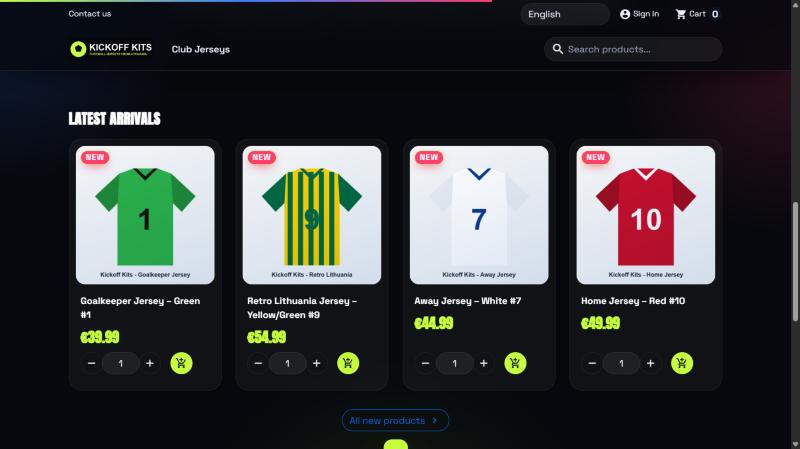
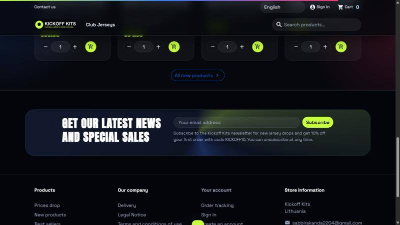

# Kickoff Kits — PrestaShop E-shop

An online football-jersey store built on **PrestaShop 9.2.1** with a fully custom animated dark theme.
It was a group project (group g15) for the **E-services for Business Management** course at Vilnius University Šiauliai Academy, made by Sabbir Hossain Akanda and Md Ashraful.


## The business

Kickoff Kits is a small (fictional) jersey shop based in Šiauliai, Lithuania. It sells club home/away jerseys, retro shirts (including a yellow-green retro Lithuania design) and goalkeeper kits to young football fans, amateur and school teams, and gift buyers.

**Catalogue:** 3 categories (Club, Retro, Goalkeeper Jerseys) and 4 products, each with descriptions, price, reference, stock and its own image.

## Theme and design work

Built on the **Hummingbird** theme, with my own [`custom.css`](theme/custom.css) and [`custom.js`](theme/custom.js) uploaded via FTP:

- Dark "stadium at night" palette with lime, blue and pink accents, Anton + Space Grotesk fonts and a slowly moving background glow
- Hero section "WEAR THE GAME." with animated text reveal, gradient shine, floating 3D jersey cards that tilt with the mouse, and count-up stats
- Scrolling marquee with offers (free delivery over €60, `KICKOFF10`, 30-day returns)
- Product cards with 3D tilt, cursor-following glow, image zoom and staggered scroll-reveal
- Glass sticky header that shrinks on scroll, scroll progress bar, page transitions (View Transitions API)
- New logo for the dark theme
- Fully responsive, and respects `prefers-reduced-motion`
- Store configuration: name, country, timezone, SSL; demo content replaced

## Screenshots

| Products | Product page |
|---|---|
|  |  |

| Marquee and welcome | Newsletter | Mobile |
|---|---|---|
|  |  |  |

## Repository contents

```
theme/        custom.css and custom.js added to the Hummingbird theme
assets/       logos, banner and product images
screenshots/  the finished store
```

The store itself ran on the university's PrestaShop sandbox. This repo holds the customisation code and assets.
